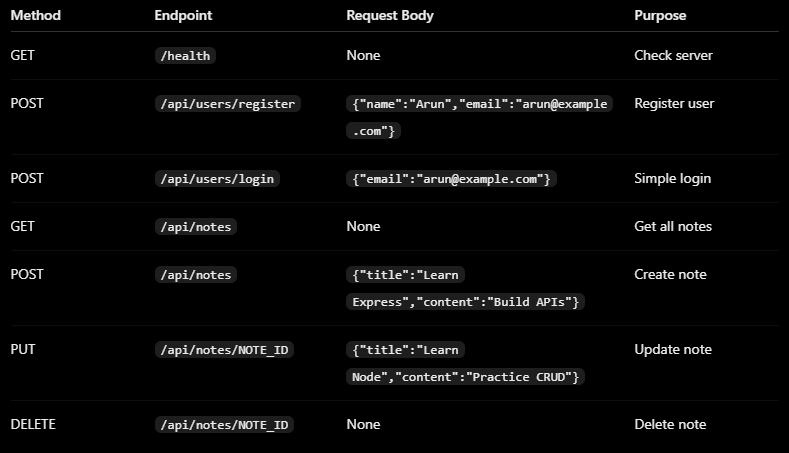

Create and Add .env file and a PORT variable with 8081 or suitable port numbers

Test the API in Postman
Base URL: http://localhost:8081

Application Flow

                 CLIENT (Postman)
                   |
                   v
                 ROUTES
                   |
                   v
               MIDDLEWARE
             (Input Validation)
                   |
                   v
          +--------+--------+
          |                 |
          v                 v
      SECURITY          CONTROLLER
   (Register/Login)    (Notes CRUD)
          |                 |
          v                 v
          +------ SERVICES--+
                   |
                   v
                 MODELS
                   |
                   v
             ARRAYS IN MEMORY